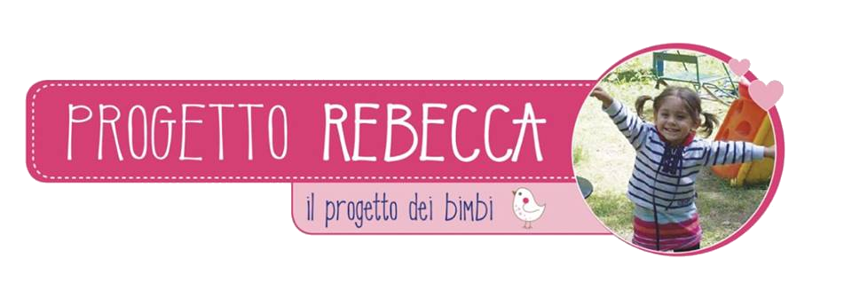

<p align="center">
  
</p>

<h1 align="center">Progetto Rebecca</h1>

<p align="center">
  <strong>Il progetto dei bimbi</strong><br>
  Un archivio vivo di storie, progetti e memoria.
</p>

<p align="center">
  <a href="https://www.progettorebecca.org/">Sito ufficiale</a> ·
  <a href="https://www.facebook.com/ProgettoRebecca">Facebook</a> ·
  <a href="mailto:info@progettorebecca.org">info@progettorebecca.org</a>
</p>

---

## Una storia che continua

Il Progetto Rebecca nasce il 2 ottobre 2012, dopo la perdita di Rebecca, per trasformare il dolore in aiuto concreto ai bambini.

Da allora l'associazione ha sostenuto il **Kindergarten Rebecca a Ranchi, in India**, le **scuole del VCO**, lo **sport giovanile** e il **Parco Giochi di Rebecca** a Villa Olimpia, a Verbania.

Questo sito raccoglie le storie, le fotografie e i video di quel percorso: un luogo di memoria, ma anche un modo per continuare a fare del bene.

> …GRAZIE CON REBECCA NEL CUORE…

## Il sito in numeri

| Storie | Fotografie in gallery | Video | Anni |
|:---:|:---:|:---:|:---:|
| **142** | **120** | **23** | **2013–2018** |

## Cosa trovi

- **Home** — il progetto, la storia e le ultime notizie.
- **Chi siamo** — Rebecca, la famiglia e la nascita dell'associazione.
- **Progetti** — Kindergarten, scuole, sport e Parco Giochi.
- **Il diario** — l'archivio completo delle 142 storie, con ricerca e filtri per anno.
- **Gallery** — una selezione di 120 fotografie e tutti i video storici.
- **Donare** — bonifico, 5 per mille e sostegno a distanza.
- **Contatti** — informazioni, sedi e modulo di contatto via email.
- **Privacy** — come vengono gestiti dati, cookie e contenuti esterni.

## Come è fatto

Il sito è **statico**: non usa database, CMS o framework.

| Area | Scelta |
|---|---|
| Pagine | HTML5 |
| Stile | CSS personalizzato con variabili |
| Interazioni | JavaScript vanilla |
| Video | YouTube con dominio `youtube-nocookie`, caricati solo dopo un clic |
| Dati | JSON statici |
| SEO | canonical, Open Graph, `sitemap.xml`, `robots.txt` |
| Redirect | `_redirects` per i vecchi URL |
| Deploy | Netlify o Cloudflare Pages |

Non è necessaria una build di produzione: la cartella del progetto è già il sito pubblicabile.

## Struttura

```text
.
├── index.html
├── chi-siamo.html
├── progetti.html
├── eventi.html
├── gallery.html
├── donare.html
├── contatti.html
├── privacy.html
├── ulmi.html
├── 404.html
├── eventi/                 # 142 pagine articolo
├── assets/
│   ├── css/style.css
│   ├── js/main.js
│   ├── js/archive.js
│   ├── img/                # logo, ritratto, foto, miniature e poster video
│   └── data/               # news.json e videos.json
├── content/articles.json   # dati completi degli articoli
├── tools/
│   ├── build.py            # importazione e generazione dell'archivio
│   ├── check_links.py      # controllo dei link locali
│   └── templates/
├── _redirects
├── netlify.toml
├── sitemap.xml
└── robots.txt
```

## Sviluppo locale

Serve Python 3 per l'anteprima locale.

```powershell
python -m http.server 8765
```

Poi apri <http://127.0.0.1:8765/>.

## Rigenerare l'archivio

```powershell
$env:PYTHONUTF8='1'

# rigenera le pagine senza riscaricare le immagini
python tools/build.py --no-media

# controlla i link locali
python tools/check_links.py
```

Il comando completo `python tools/build.py` riscarica i media e richiede gli HTML originali archiviati localmente. Non serve per il deploy.

## Deploy

Il sito è pronto per Netlify o Cloudflare Pages collegando questo repository Git.

- **Build command:** nessuno
- **Publish directory:** `.` (radice del progetto)
- **Redirect:** gestiti da `_redirects`
- **Dominio:** `progettorebecca.org`

## Privacy

Il sito non usa cookie di profilazione e non ha un backend. Il modulo contatti apre il programma di posta dell'utente. I video YouTube vengono caricati solo dopo un clic, tramite `youtube-nocookie`.

## Contatti

- Email: [info@progettorebecca.org](mailto:info@progettorebecca.org)
- Telefono: [347 5024855](tel:+393475024855)
- Facebook: [ProgettoRebecca](https://www.facebook.com/ProgettoRebecca)
- Sede legale: Via Indipendenza 16, Oltrefiume di Baveno (VB)
- Sede operativa: Via San Remigio 20/B, Casa Nazareth, Villa Chaminade

## Contenuti e diritti

Le storie, le fotografie e i video sono pubblicati per conservare la memoria del Progetto Rebecca. Per riutilizzi e richieste editoriali contattare l'associazione.
